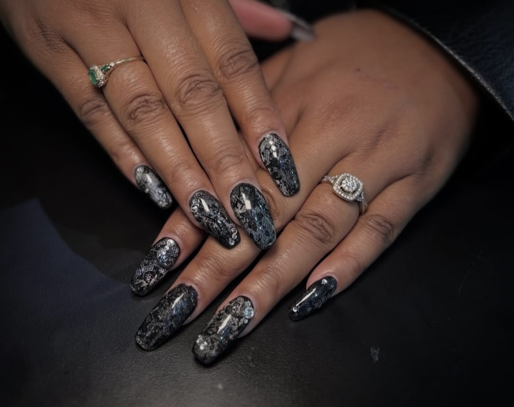
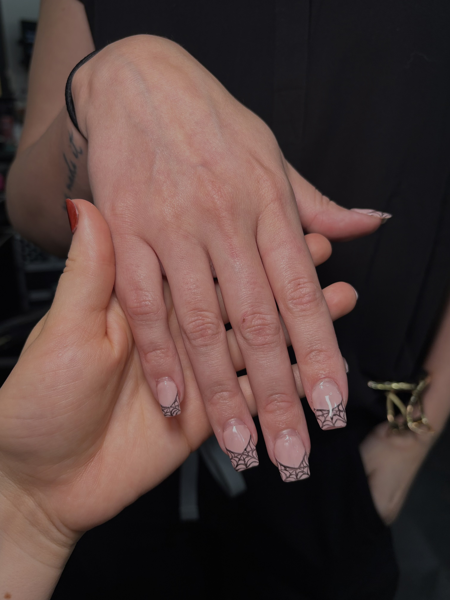
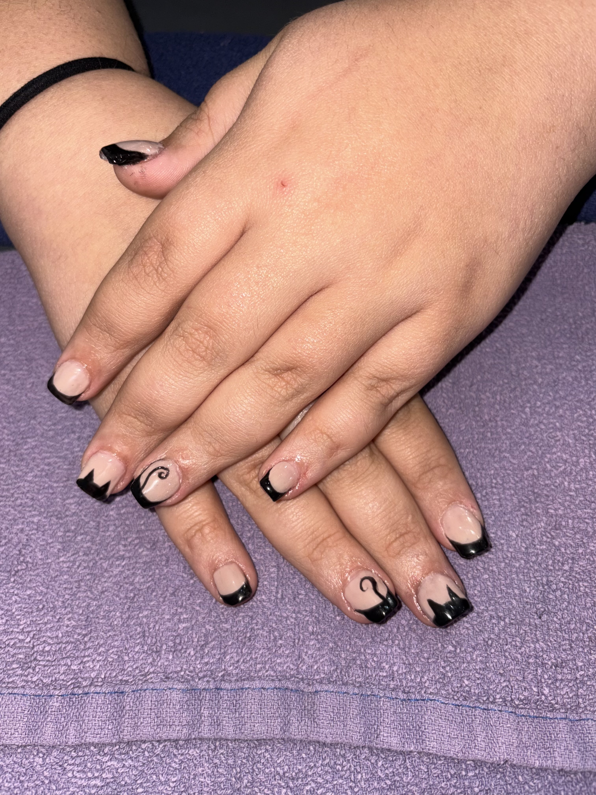
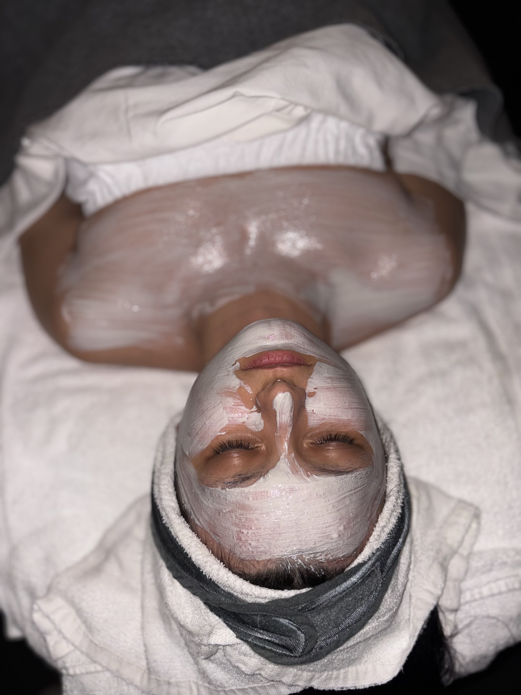

<!DOCTYPE html>
<html lang="en">
<head>
  <meta charset="UTF-8">
  <meta name="viewport" content="width=device-width, initial-scale=1.0">
  <title>Kaylee McMacken | Professional Cosmetologist</title>
  <!-- Modern Google Fonts -->
  <link rel="preconnect" href="https://googleapis.com">
  <link rel="preconnect" href="https://gstatic.com" crossorigin>
  <link href="https://googleapis.com/css2?family=Inter:wght@300;400;500;600&family=Playfair+Display:ital,wght@0,400;0,600;1,400&display=swap" rel="stylesheet">
  
  
</head>
<body>

  <!-- Premium Header Bar Navigation -->
  <header class="header-bar">
    
@kayleescosmicbliss

    <nav class="nav-links" id="navLinks">
      <button id="btn-about" onclick="showSection('about')">About</button>
      <button id="btn-gallery" onclick="showSection('gallery')">Gallery</button>
      <button id="btn-videos" onclick="showSection('videos')">Videos</button>
      <button id="btn-contact" onclick="showSection('contact')">Contact</button>
      <a href="tel:7192669400" class="book-btn">Book Now</a>
    </nav>
  </header>

  <!-- Principal Structural Page Content -->
  <main class="main-content">
    
    

      <h1 id="sectionTitle">Portfolio</h1>
      
Full-service cosmetologist. Explore my portfolio and book your appointment today :)

    

    <!-- About Section -->
    <section id="about" class="portfolio-section">
      

        <h2 style="font-family: 'Playfair Display', serif; margin-bottom: 20px;">Hi, I'm Kaylee McMacken</h2>
        
Welcome to my cosmic oasis! As a  cosmetology student, I specialize in transforming hair - particularly curly hair, skin, and nails to help my clients look and feel their absolute best.

      

    </section>

    <!-- Gallery Section -->
    <section id="gallery" class="portfolio-section">
      

        

          <text x=\'10\' y=\'30\'>Gallery Image 1</text></svg>'">
        

        

          <text x=\'10\' y=\'30\'>Gallery Image 2</text></svg>'">
        

        

          <text x='10' y='30'><text x=\'10\' y=\'30\'>Gallery Image 3</text></svg>'">
        

        

          <text x='10' y='30'><text x=\'10\' y=\'30\'>Gallery Image 4</text></svg>'">
        

      

    </section>
	
    <!-- Videos Section -->
    <section id="videos" class="portfolio-section">
		

		  

			<video controls>
			  <source src="./assets/videos/vid1.mp4" type="video/mp4">
			  Your browser does not support the video tag.
			</video>
		  

		  

			<video controls>
			  <source src="./assets/videos/vid2.mp4" type="video/mp4">
			  Your browser does not support the video tag.
			</video>
		  

		  

			<video controls>
			  <source src="./assets/videos/vid3.mp4" type="video/mp4">
			  Your browser does not support the video tag.
			</video>
		  

		  

			<video controls>
			  <source src="./assets/videos/vid4.mp4" type="video/mp4">
			  Your browser does not support the video tag.
			</video>
		  

		

	</section>

    <!-- Contact Section -->
    <section id="contact" class="portfolio-section">
      <form class="contact-form" onsubmit="event.preventDefault(); alert('Message sent successfully!');">
        

          <label for="name">Your Name</label>
          <input type="text" id="name" required placeholder="Enter your full name">
        

        

          <label for="email">Email Address</label>
          <input type="email" id="email" required placeholder="kayleemcmacken2003@gmail.com">
        

        

          <label for="message">Your Message</label>
          <textarea id="message" required placeholder="Tell me about the services you're interested in..."></textarea>
        

        <button type="submit" class="submit-btn">Send Message</button>
      </form>
    </section>

  </main>

  

</body>
</html>
